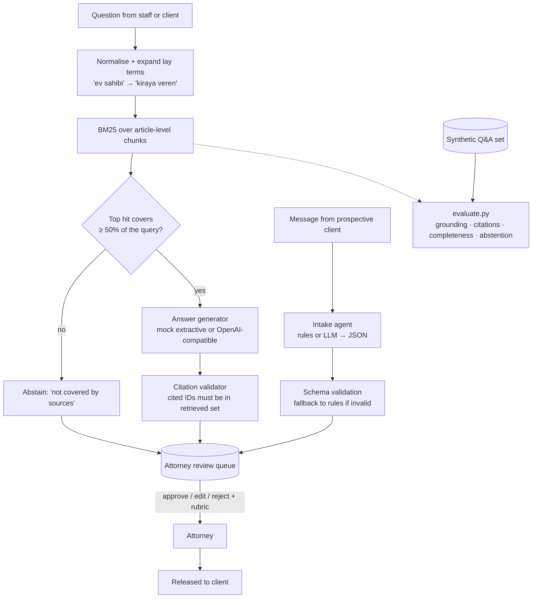

# turkish-legal-rag-intake

[](https://github.com/onurratarr/turkish-legal-rag-intake/actions/workflows/ci.yml)

> **Reference implementation.** This repository is inspired by a client project I delivered for a private law firm in
> Turkey (a Turkish-language legal RAG assistant and a client-intake agent, with attorney human-in-the-loop review and
> an accuracy rubric). **It is not the client's code and contains no client data.** The sample documents in
> `data/docs/` are **synthetic** — written for this demo, not real statutes or court decisions — and must not be used
> as legal advice.

A Turkish legal assistant that answers questions **only from retrieved sources, with citations**, declines when the
sources don't cover the question, turns free-text messages from prospective clients into **structured intake JSON**,
and routes everything through an **attorney review queue** before anything reaches a client.

## Language note

The code, docs and comments are in English. The sample corpus, the evaluation questions and the assistant's answers are
in **Turkish**, because that is the setting this demo reproduces. English glosses are given below.

## What's inside

| Piece | Where |
|---|---|
| Synthetic Turkish sample corpus: 6 documents / 18 citable articles (tenancy, employment, consumer, family, inheritance, one court-decision summary) | `data/docs/` |
| Corpus loader → one chunk per article, citation IDs like `SYN-KIRA-01 m.2` (*m.* = *madde*, article; *b.* = *bölüm*, section) | `legal_rag/corpus.py` |
| Turkish normalisation, first-5-character stemming, lay-term → legal-term query expansion | `legal_rag/text.py` |
| BM25 retrieval (no external dependencies) | `legal_rag/retrieval.py` |
| Citation-grounded answering: offline extractive **mock** backend + optional **OpenAI-compatible** backend, citation validation, abstention | `legal_rag/answer.py` |
| Client-intake agent → validated JSON (matter type, urgency, contacts, dates, amounts, missing fields, proposed consultation slot) | `legal_rag/intake.py` |
| Attorney review queue (approve / edit / reject + rubric scores), SQLite | `legal_rag/review.py` |
| Review rubric + automatic eval over a synthetic Q&A set | `RUBRIC.md`, `legal_rag/evaluate.py`, `data/eval/qa.jsonl` |
| Tests (pytest) | `tests/` |

## Architecture



## Quickstart in 3 commands

```bash
python -m venv .venv && . .venv/bin/activate && pip install -r requirements.txt
python -m legal_rag.cli demo      # ask → intake → attorney review, fully offline
python -m pytest -q               # tests
```

Run the rubric eval with `python -m legal_rag.evaluate` (writes `eval/results.md`).

### Ask a question

```bash
python -m legal_rag.cli ask "Ev sahibi depozitoyu ne zaman iade etmek zorunda?"
# "When must the landlord return the deposit?"
```

```text
Kaynaklara göre:
- Kiraya veren, sözleşmenin sona ermesinden ve anahtarların teslim edilmesinden itibaren 15 gün içinde depozitoyu
  iade eder. Kiraya veren, belgelenmiş hasar bedelini depozitodan düşebilir. [SYN-KIRA-01 m.3]
- Kiracı, tahliyeden sonra depozitonun iade edilmediğini ileri sürmüştür. ... [SYN-KARAR-01 b.1]

Not: Bu taslak yanıt avukat onayı olmadan müvekkile iletilmez.

[queued for attorney review as item #1; citations=['SYN-KIRA-01 m.3', 'SYN-KARAR-01 b.1']; abstained=False]
```

Gloss: "According to the sources: the landlord returns the deposit within 15 days of the end of the contract and the
handover of the keys, and may deduct documented damage [article 3] … (plus the facts of a synthetic court decision).
Note: this draft is not sent to the client without attorney approval."

A question the corpus does not cover — e.g. *"Trafik cezasına itiraz süresi nedir?"* ("What is the deadline to appeal
a traffic fine?") — returns an abstention instead of a guess.

### Intake

```bash
python -m legal_rag.cli intake "Merhaba, adım Ayşe Yılmaz. 3 yıldır çalıştığım işyerinden 12.10.2026 tarihinde \
çıkarıldım, kıdem tazminatımı ödemediler. Telefonum 0532 000 00 00. Yarın işverenle görüşmem var, acil."
# "Hi, I'm Ayşe Yılmaz (fictional). I was dismissed on 12.10.2026 after 3 years, my severance wasn't paid.
#  My phone is ... I meet my employer tomorrow, it's urgent."
```

```json
{
  "client_name": "Ayşe Yılmaz",
  "phone": "05320000000",
  "email": null,
  "matter_type": "employment",
  "matter_confidence": 1.0,
  "urgency": "high",
  "key_dates": ["12.10.2026"],
  "amounts_try": [],
  "summary": "Merhaba, adım Ayşe Yılmaz. ...",
  "missing_fields": [],
  "conflict_check_required": true,
  "proposed_consultation": "2026-11-03T10:00",
  "source": "rule_based",
  "validation_errors": []
}
```

### Attorney review

```bash
python -m legal_rag.cli review list
python -m legal_rag.cli review approve 1 --reviewer "Av. Demo" --rubric accuracy=2,grounding=2,citation=1,completeness=2,risk=2
python -m legal_rag.cli review edit 2 --reviewer "Av. Demo" --set proposed_consultation=2026-11-04T11:00
python -m legal_rag.cli review reject 3 --reviewer "Av. Demo" --note "needs the case file"
```

Only `approved` or `edited` items are ever returned by `ReviewQueue.released()`. Edits keep both the original draft and
the attorney's final version, which is what you need to improve prompts and retrieval later.

## Evaluation (synthetic data)

`python -m legal_rag.evaluate` scores the assistant on 12 synthetic questions (10 answerable, 2 deliberately not
covered by the corpus) with the metrics described in [RUBRIC.md](RUBRIC.md). The table below was produced by running
it with the default mock backend; it describes this demo only.

| metric | value |
|---|---|
| questions | 12 |
| pass rate | 1.00 |
| abstention accuracy | 1.00 |
| grounding | 1.00 |
| citation precision | 0.90 |
| citation recall | 1.00 |
| completeness | 1.00 |

Full per-question table: [eval/results.md](eval/results.md). Read these numbers with care: the mock backend is
*extractive*, so grounding is 1.00 by construction, and the corpus is small and was written alongside the questions.
Citation precision is below 1.00 because for two questions the retriever also cites a related but non-required article.
The metrics matter most when you switch to a generative backend (`LLM_BACKEND=openai`); the tests show the grounding
and citation checks catching an unsupported sentence and a hallucinated article number.

## Use a real LLM (optional)

```bash
cp .env.example .env    # set LLM_BACKEND=openai and OPENAI_API_KEY (any OpenAI-compatible endpoint)
LLM_BACKEND=openai OPENAI_API_KEY=... python -m legal_rag.cli demo
```

## How this maps to a forward-deployed engagement

- **Scoping.** Sit with the attorneys to pick the practice areas, the source documents they trust, and what the
  assistant must never do (give final advice, guess when sources are missing). Those decisions become the corpus, the
  abstention rule and the review policy.
- **Integration.** Ingest the firm's own documents with article-level chunking, route intake into the firm's matter
  types, and put every draft into an attorney review queue rather than straight to the client.
- **Evaluation.** Agree an accuracy rubric with the attorneys, build a labelled question set (including unanswerable
  questions), and gate retrieval/prompt changes on it in CI (see
  [llm-eval-harness](https://github.com/onurratarr/llm-eval-harness) for judge-based scoring and annotator agreement).
- **Rollout.** Internal use first, attorneys reviewing every answer and scoring it with the rubric; widen scope only as
  review data shows the answers hold up.

## Design decisions (the forward-deployed parts)

- **Attorney in the loop by construction.** The system produces drafts; release is a separate, attributable human
  decision with a reason for rejections. This matches how a law firm actually takes responsibility for advice.
- **Abstain instead of guessing.** If retrieval doesn't cover the question, the assistant says so and routes it to an
  attorney. A confident wrong answer is the worst outcome in this domain.
- **Citations are checked, not trusted.** Any citation that isn't in the retrieved set is flagged
  (`invalid_citations`), so a model inventing "article 9" is caught before review.
- **Article-level chunks.** Lawyers cite articles, so chunks and citation IDs follow the document structure.
- **Turkish-specific retrieval.** Turkish is agglutinative (`tazminat`, `tazminatı`, `tazminatımı`), so a simple
  first-5-character stemmer plus a small, legal-team-owned lay-term dictionary (`ev sahibi` → `kiraya veren`) gets
  most of the benefit before reaching for embeddings.
- **Structured intake with a safe fallback.** LLM intake output must pass schema validation; otherwise the rule-based
  extractor is used and the errors are recorded. Conflict checks are always flagged for a human.
- **Measure before and after changes.** A labelled Q&A set and automatic proxies for the review rubric make retrieval
  or prompt changes testable in CI; `tests/test_eval.py` enforces regression floors.

## Limitations

Small synthetic corpus; BM25 only (embeddings would be the next step for paraphrased questions); rule-based intake
lexicon; no authentication or audit log beyond the review table; consultation slots come from a static synthetic
calendar.

## License

MIT
